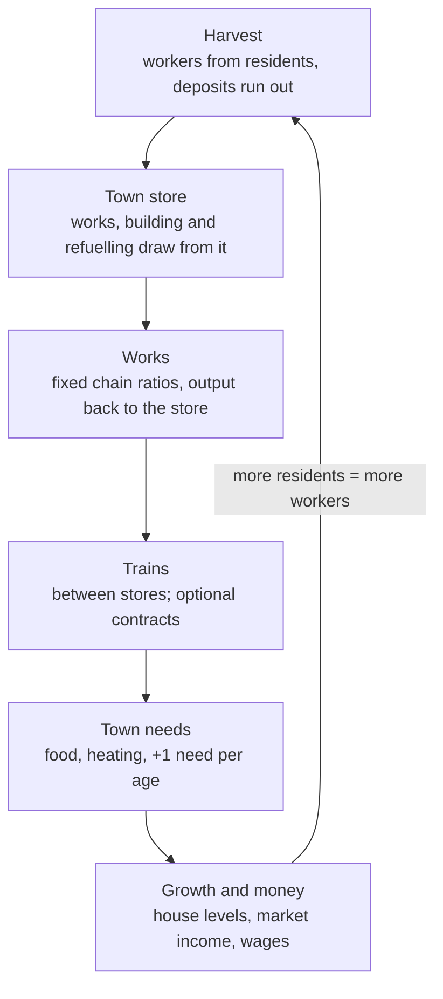

# Production loop: works, resources, population and roads in one balanced loop

Issue #306 (epic #46). Author: Zsolt, with Claude as Core. Date: 2026-10-27.
Status: approved by the author on 2026-10-27, with the answers to its open points (section 15).
It changes no code.

The numbers here come from a balance model, `2026-10-27-production-loop-model.ts` beside this file.
Run it with `node docs/superpowers/specs/2026-10-27-production-loop-model.ts`. Every number quoted
below is a constant in that file.

## 1. Goal and non-goals

**Goal.** Works, harvesting, population with professions, roads, trains and money make one loop:

- every part feeds the next;
- every age's network sustains itself;
- the six ages take about ten hours at 1x.

The loop replaces today's global stockpile, today's lopsided rates and the gacha.

**Today's problems** (measured on `develop` at `f095a1c`):

- The rates do not match each other:
  - one moving Rocket burns about 7.8 coal a minute, while a Kiln makes 1.4;
  - a Grinder needs 6.7 quarries;
  - a harvester's 30 units a week fill a starter train in about 30 minutes.
- **Works output earns nothing.**
  - Contracts start only at harvesting stations, so coal, iron, food and oil never appear in one.
  - The station market price is shown but never paid.
- **Ages are badly paced.** Nuclear comes with a single powered Battery. Magnetic needs 50 000
  earned, Hyper 500 000.
- **Tickets have no sink.** The gacha screen is unreachable, and the game is no longer a gacha game
  (author, 2026-10-27).
- **Crafting ignores the age.** An electric recipe can be drawn in Steam.

**Non-goals:**

- financial buildings, loans and interest (a later sub-project, which the author asked for);
- the trains, buildings and art of the three new ages;
- track classes (`specs/track-classes.md` on the author's drive);
- map generation changes.

## 2. Decisions

The author's answers, 2026-10-27:

| #   | Question                                  | Answer                                                                    |
| --- | ----------------------------------------- | ------------------------------------------------------------------------- |
| Q37 | Where do works take inputs and put output | the nearest town store (section 6)                                        |
| —   | Where does building material come from    | the nearest store holding it, within 24 tiles (section 6)                 |
| Q38 | Are walkers the production                | a rate computed from workers, distance and roads; walkers show it         |
| Q39 | Do workers come from residents            | yes; a short-staffed building works slower                                |
| Q40 | Which model game                          | Anno 1800 chain ratios, with Victoria-style needs that unlock growth      |
| Q41 | How to fix the rate scale                 | recompute everything from one unit (section 5)                            |
| Q42 | Do deposits run out                       | yes, kept in the save; forests regrow                                     |
| Q43 | Where do seams come from                  | computed in the game from terrain and seed; map generation is unchanged   |
| Q44 | What can works output be sold for         | town markets at shortage prices, and contracts from works                 |
| Q45 | More needs than food                      | one new need per age                                                      |
| Q46 | Design target                             | the Full chain; Simple is a relaxed version derived from it               |
| —   | Age goals                                 | from needs and population                                                 |
| —   | A recipe switch on upgrade                | only where it makes sense, chosen in the building (section 8)             |
| —   | Role of money                             | wages in money; land is the main late sink; tickets go; finance later     |
| —   | Contracts                                 | "very little role": rare, optional, no penalty, only an advantage if done |

The earlier rules stay: wood is no longer a locomotive fuel (#332), and roads are built by the
player and walked about twice as fast (Q36).

## 3. The loop

## 4. What is taken from the reference games

| Game            | Taken                                                      | Why                                                 |
| --------------- | ---------------------------------------------------------- | --------------------------------------------------- |
| Anno 1800       | fixed chain ratios; a need per population tier; tier = age | readable ("1 farm + 1 mill feed 120"); plannable    |
| Victoria 3      | prices from shortage; needs that gate growth               | trains carry goods to where they are scarce         |
| OpenTTD, TF2    | trains move goods between stores; money upkeep             | the railway is the logistics, and a poor line costs |
| Factorio        | throughput thinking: a works runs at its slowest input     | bottlenecks are visible and fixable                 |
| Paradox (wages) | wages follow the age's standard of living                  | upkeep stays a steady share of income in every age  |

## 5. Anchors and tempo

All rates are per real minute at 1x. A game day is 4 minutes and a game hour 10 seconds.

| Anchor                          | Value                                                              | Today                       |
| ------------------------------- | ------------------------------------------------------------------ | --------------------------- |
| One worker, 3 tiles out, road   | 1.5 units a minute (25 s work, 15 s walk); 1.1 without a road      | –                           |
| Harvester L1, 4 workers         | 6 units a minute                                                   | about 1.07                  |
| Works L1                        | takes one harvester's output (e.g. Kiln 6 wood → 3 coal)           | Kiln 1.43 coal              |
| Engine fuel                     | 10 % of what it hauls; steam adds 1.25 water per coal              | Rocket 7.8 coal + 9.4 water |
| Starter narrow train (30 units) | fills from one harvester in about 5 minutes                        | about 30 minutes            |
| Food                            | 0.05 per resident a minute; 1 farm + 1 windmill feed 120 residents | 300 residents               |
| Working residents               | half of all residents                                              | –                           |
| Levels                          | jobs ×1, 1.5, 2.25, 3.25, 4.5, 6; output per worker +10 % a level  | output 1 + 0.5 a level      |

**Tempo**, as measured by the model's reference player:

| Age reached | Target | Model  | Goal (section 8)            |
| ----------- | ------ | ------ | --------------------------- |
| Diesel      | 1 h    | 55 min | 550 residents               |
| Electric    | 2.5 h  | 2.7 h  | 700 residents at level 2+   |
| Nuclear     | 4.5 h  | 4.3 h  | 1 800 residents at level 3+ |
| Magnetic    | 7 h    | 6.8 h  | 3 000 residents at level 4+ |
| Hyper       | 10 h   | 9.7 h  | 4 600 residents at level 5+ |

**Sensitivity.** With town growth at 0.8× or 1.25×, each age arrives within about 15 minutes of the
times above (0.8× brings Diesel 10 minutes late, 1.25× Hyper 15 minutes late). The tempo rests on the chains, not on growth
alone.

## 6. Town stores (sub-project 1)

- **A town's store** is the pooled storage of the Warehouses within its reach (`TOWN_RADIUS`, 7
  tiles round the Townhouse).
  - The Townhouse itself holds 300 units, so a town works before it has a Warehouse.
  - Capacity: 300 + 1 000 per Warehouse level.
- **A depot is a store too.** The start stock lies in the start depot. Nothing feeds a global
  stockpile any more.
- **Who draws from where:**

  | Who                                          | Takes from / gives to                                                |
  | -------------------------------------------- | -------------------------------------------------------------------- |
  | Works in a town's reach                      | that town's store                                                    |
  | Harvester in a town's reach                  | workers carry output straight to the store                           |
  | Harvester outside towns                      | its own storage, as today; trains collect it                         |
  | Houses (food, heating, the age's needs)      | their town's store                                                   |
  | Fuel buildings                               | the town's store in a town; outside, their own tank, filled by train |
  | Trains                                       | load and unload at a town's station, into and out of its store       |
  | Building (track, stations, houses, upgrades) | the nearest store holding the material, within 24 tiles              |

- **Building further away** than 24 tiles needs a forward Warehouse or depot filled by train.
- **Top bar:** it shows the selected town's (or depot's) store and a total.
- **Simple mode:** every store on one connected rail network acts as one pool, which is close to
  today's game.

## 7. Workers and depletion (sub-project 2)

**Jobs.** Every station and works has jobs, which grow with its level (×1 … ×6, section 5).

- **Who fills them:** residents of houses within 12 tiles (24 along a road).
- **In which order:** the nearest building first. Pausing a building frees its workers.
- **Without workers** a building makes nothing. A remote deposit needs houses beside it or a road to it.
- **Engines take no residents.** Their crews are paid wages (section 10).

**Rate:**

rate = base × staffing × trip factor × richness × season × biome

- **Staffing** is filled jobs ÷ jobs.
- **Trip factor** (harvesters only) is work ÷ (work + walk), at the walker's 0.2 tiles a second (0.4
  on a road). The 1.5 a minute anchor is 3 tiles out on a road.
- **Works** have no walk: staffing alone.
- **Walkers** show this rate; their trips are not saved (Q38).

**Depletion:**

| Deposit                 | Runs out | Holds                                                                                           |
| ----------------------- | -------- | ----------------------------------------------------------------------------------------------- |
| Rock, hill, mountain    | yes      | 80 / 40 / 150 stone a tile; a typical quarry about 2 000                                        |
| Iron ore and coal seams | yes      | 1 500–3 000 a site, by richness                                                                 |
| Oil field               | yes      | about 3 000 crude                                                                               |
| Forest                  | regrows  | 40 wood a tile, 1 wood back every 2 minutes; a lumber yard with 12+ forest tiles in reach lasts |
| Fields, water           | no       | –                                                                                               |

- **Shown:** the tooltip and the station panel show what is left and roughly how long it lasts.
- **A worked-out station stops.**
- **Seams (Q43):** they are computed from rock, hill and mountain tiles and the seed. Placing a
  station shows its seam in the tooltip ("coal seam, about 2 400").

## 8. Needs, house levels and age goals (sub-project 3)

**Needs.** Each age adds one need. A resident in a house of level L consumes the needs of ages
0 … L−1.

| Age      | New need    | Made by                                         | Per resident a minute |
| -------- | ----------- | ----------------------------------------------- | --------------------- |
| Steam    | food        | farm → windmill                                 | 0.05                  |
| Steam    | heating     | coal (Kiln, coal pit); winter 1.5×, spring 0.5× | 0.012                 |
| Diesel   | goods       | **new: Workshop** (iron + wood → goods)         | 0.02                  |
| Electric | power       | power plant → power line or Battery, no train   | 0.04                  |
| Nuclear  | electronics | Wire Mill → **new works** (wire + iron)         | 0.01                  |
| Magnetic | plastics    | **new works** (crude → plastics)                | 0.012                 |
| Hyper    | luxury      | **new works** (electronics + plastics)          | 0.006                 |

The author kept plastics and luxury for Magnetic and Hyper (2026-10-27). Electronics gives wire,
which has no consumer today, a use.

**House levels:**

- **Moving up:** a house moves up a level when every need of its level has been met at 90 % or
  more for a full day. The upgrade costs materials, as today, and the level must be open in the
  current age.
- **Unmet needs:**

  | An unmet need lasts | What happens                                                          |
  | ------------------- | --------------------------------------------------------------------- |
  | 1 day               | the house stops growing                                               |
  | 3 days              | 10 % of its residents leave a day, down to the level below's capacity |

- Famine becomes a town's affair, not the whole game's.

**Age goals** replace "earned", "chunks" and "substations":

| To reach | Residents | At house level |
| -------- | --------- | -------------- |
| Diesel   | 550       | 1+             |
| Electric | 700       | 2+             |
| Nuclear  | 1 800     | 3+             |
| Magnetic | 3 000     | 4+             |
| Hyper    | 4 600     | 5+             |

Every need of those levels must be met when the goal is checked.

**A new age** gives one free recipe draw from that age and opens its works. It replaces the +5
tickets.

**Crafting follows the age.** Only recipes of the current or an earlier age can be drawn.

**Recipe switches** (author, 2026-10-27). At the level named below, a works offers a second
recipe. The player picks it in the building's panel and can switch back at any time:

| Works           | From level          | Second recipe                 | Why                                         |
| --------------- | ------------------- | ----------------------------- | ------------------------------------------- |
| Kiln            | Electric (L3, last) | 6 wood → 8 power              | power from wood where there is no coal      |
| Ironworks       | Electric            | 4 iron ore + 4 power → 3 iron | the electric arc furnace: iron without coal |
| Power plant     | Diesel              | 3 crude + 3 water → 12 power  | oil firing; today's `altIn`, dead in Full   |
| Diesel refinery | Magnetic            | 6 crude → 3 plastics          | petrochemicals for Magnetic's new need      |

The author called these examples. More come only where a switch serves an age's need or
technique, never as filler. A second recipe follows the level as any recipe does.

## 9. Market and contracts (sub-project 4)

**The town market is the main income.** Residents pay for what they consume from their town's
store, at the town's price.

| Stock in the store | Price     |
| ------------------ | --------- |
| under 1 day        | 1.5× base |
| 2–4 days           | 1.0×      |
| over 5 days        | 0.7×      |

- Prices move linearly between the bands. Carrying goods to a town short of them pays best.
- The station panel shows the price that is really paid.
- The trade desk stays as a fallback: it sells at 0.6× and buys at 1.6×.
- Passenger fares stay as they are.

**Contracts are a minor, optional bonus** (author, 2026-10-27):

- **Offers are rare:** about one every 3 game days (12 minutes). At most 2 offers and 1 accepted
  contract at a time.
- **No penalties:** an offer that expires vanishes, cancelling is free, and a late delivery simply
  earns nothing.
- **Reward:** about 1.5× the market price. Rare or better adds a small extra, such as one free
  recipe draw or a town growing faster for a few days.
- **Cargo:** a contract may start at any station or town store, so works output (iron, goods,
  electronics…) appears too.
- **Rarities stay.** Their reward per unit becomes fair: uncommon 1.7×, rare 3×, epic 5.2×,
  legendary 8.4× (amount 1.5× / 2.5× / 4× / 6×).
- **Progress never needs a contract.**

## 10. Money, wages and the end of the gacha (sub-project 5)

**Income:** the town market, fares, contracts and trade desk sales.

**Costs:**

- **Wages:** every filled job and every engine crew of 3 is paid the age's wage, per minute:

  | Age  | Steam | Diesel | Electric | Nuclear | Magnetic | Hyper |
  | ---- | ----- | ------ | -------- | ------- | -------- | ----- |
  | Wage | 1.1   | 2.0    | 3.6      | 6.5     | 7.0      | 8.0   |

  Wages follow the age because people spend more in later ages, so upkeep stays at 22–31 % of
  income in every age (model, section 11).

- **No track upkeep.**
- **Land is the main late-game sink** (author, 2026-10-27). Each chunk costs 12 % more than the
  one before: the 2nd 12 000, the 10th about 30 000, the 20th about 92 000, the 46th about 1.76 M.
  Deposits drive the buying: a chunk offers about 4 quarry, mine, pit or oil sites, and a
  worked-out site keeps its ground. In the model land takes about 16 M over the game.
- **What else money buys:** recipe draws, in-cab fit-out, trade desk buys.

**In the red:**

- There are no loans. The balance may go negative down to a limit, where building and buying stop.
- After 3 days in the red, half the unpaid workers strike, so production halves.
- Loans, interest and financial buildings are a later sub-project.

**The gacha goes:**

- **Removed:** `src/gacha/gacha.ts`, `GachaScreen`, `gacha.json` (banners, pity), tickets (from
  contracts, the daily ticket, the +5 per age, `startTickets`) and their UI.
- **Kept:** crafting, the roster, copies and merging copies (+8 % a level, up to 5).
- **Old saves** lose their tickets and keep their vehicles.

## 11. The numbers (sub-project 6)

### Target rates per minute at 1x, L1, full staff

| Building            | Target                                 | Today (L1)                         |
| ------------------- | -------------------------------------- | ---------------------------------- |
| Farm                | 6 wheat (seasons 1 / 1.1 / 1.35 / 0.5) | 1.07                               |
| Lumber yard         | 6 wood                                 | 1.07                               |
| Quarry              | 6 stone                                | 1.07                               |
| Water pump          | 6 water                                | 1.07                               |
| Mine                | 6 iron ore                             | 1.07                               |
| Coal pit (Colliery) | 6 coal from a seam                     | 4.3 coal from 1.4 wood             |
| Oil derrick         | 6 crude                                | 1.07                               |
| Copper mine         | 6 copper ore                           | 1.07                               |
| Windmill            | 6 wheat → 6 food                       | 2.1 wheat → 10.7 food              |
| Kiln (max L3)       | 6 wood → 3 coal                        | 2.9 wood → 1.4 coal                |
| Ironworks           | 4 ore + 2 coal → 3 iron                | 2.1 ore + 1.1 coal → 2.1 iron      |
| Workshop (new)      | 2 iron + 2 wood → 4 goods              | –                                  |
| Diesel refinery     | 6 crude → 4 diesel                     | 2.1 crude + 2.1 stone → 1.1 diesel |
| Power plant         | 3 coal + 3 water → 12 power            | 2.1 power                          |
| Wire mill           | 4 copper ore + 1 coal → 2 wire         | 0.9 wire                           |
| Electronics (new)   | 2 wire + 1 iron → 2 electronics        | –                                  |
| Plastics (new)      | 4 crude → 2 plastics                   | –                                  |
| Luxury (new)        | 1 electronics + 1 plastics → 2 luxury  | –                                  |

- **Engines:** fuel per tile = 0.1 × the capacity of the train the engine is built to pull ÷ 80
  tiles (a 40-tile line, there and back). For the Rocket this is 0.0375 coal a tile (today 0.1625).
  Every engine is recomputed this way from its rarity and size class.
- **Representative haul per age** (units a minute on a 40-tile line): 15 / 45 / 70 / 100 / 140 / 200.

### Prices

Base prices, times a scale of 6 in the model:

| Cargo | water | wheat, wood, stone | iron ore | coal, crude, copper ore, food | power | diesel | iron | wire | goods | plastics | electronics | luxury |
| ----- | ----- | ------------------ | -------- | ----------------------------- | ----- | ------ | ---- | ---- | ----- | -------- | ----------- | ------ |
| Price | 2     | 4                  | 6        | 8                             | 6     | 15     | 20   | 25   | 30    | 40       | 60          | 120    |

### What the model's reference player builds

| At         | Time    | Residents | Engines | Houses | Buildings                                                                                      |
| ---------- | ------- | --------- | ------- | ------ | ---------------------------------------------------------------------------------------------- |
| → Diesel   | 55 min  | 554       | 6       | 28     | 8 farms, 6 windmills, 8 lumber, 4 quarries, 2 kilns, 3 coal pits, 2 pumps, 1 mine, 1 ironworks |
| → Electric | 163 min | 884       | 22      | 33     | 12 ironworks, 10 workshops, 3 diesel refineries, 4 derricks, …                                 |
| → Nuclear  | 260 min | 2 425     | 25      | 33     | 9 power plants, 18 ironworks, 13 workshops, …                                                  |
| → Magnetic | 405 min | 4 388     | 31      | 33     | 19 electronics works, 12 wire mills, 9 copper mines, …                                         |
| → Hyper    | 580 min | 5 560     | 35      | 33     | 25 plastics works, 33 electronics works, 14 derricks, …                                        |

After Diesel the houses stop multiplying and move up levels instead, as in Anno.

**Steam's ratio**, for the tutorial and the advisor: per 120 residents, 1 farm (2 in winter), 1
windmill, 1 lumber yard with a Kiln for heating, and 1 quarry and 1 lumber yard for building; about one
starter engine carries for every 100 residents.

| Age      | Income / h | Upkeep / h | Upkeep share |
| -------- | ---------- | ---------- | ------------ |
| Steam    | 21 600     | 5 200      | 24 %         |
| Diesel   | 118 000    | 37 000     | 31 %         |
| Electric | 539 000    | 139 000    | 26 %         |
| Nuclear  | 1.84 M     | 421 000    | 23 %         |
| Magnetic | 2.93 M     | 758 000    | 26 %         |
| Hyper    | 3.51 M     | 1.12 M     | 32 %         |

### Findings from the model

1. **Land takes the late money.** With flat land prices the player held 10 M at Hyper and 20 M at
   12 hours. With each chunk 12 % dearer and deposits needing fresh ground, it holds 0.7 M at
   Nuclear, 3.4 M at Magnetic, 4.4 M at Hyper and about 0.2 M at 12 hours, and the tempo is
   unchanged. At 0.8× and 1.25× town growth the ages move by at most 15 minutes. A 10 % step with
   3 sites a chunk stops the player just short of Hyper, so these two numbers are the land's dials.
2. **Old engines linger.** Steam engines cost no goods, so the player keeps building them after
   Diesel. Older engines should cost more upkeep in later ages, or their recipes should retire.
   This is decided in sub-project 6.
3. **Building materials are the real brake.** Stone was the bottleneck while houses moved up. The
   house level costs (`houses.json`) are kept, and the model's tempo depends on them.

### How the model works and what it leaves out

- One step every half minute, for 12 hours. One stockpile stands for every town store.
- Trains are a haulage capacity that 60 % of all output must pass through. Engines take their own
  fuel where it is made.
- The reference player plans by capacity (Anno ratios). When a cargo is made more slowly than it
  is wanted, it builds or upgrades that cargo's maker.
- Land: 14 buildings a chunk (a house counts as a quarter) and 4 deposit sites a chunk.
- **Left out:** distances, roads, single towns, seasons' storage play, contracts, passengers,
  recipe switches and chunks' terrain.
- **Sub-project 6** turns the model into a test on `src/testing/simWorld.ts` that checks the real
  simulation against these tables.

## 12. Simple mode

Simple is derived from Full by removing, never by tuning separately:

- **Stores** on one rail network pool (section 6).
- **No sand or copper.** Wire and electronics come from a single works, which takes iron and coal.
- **The Grinder replaces mine + ironworks:** 8 stone → 2 iron.
- **The Oil Refinery (coal → oil)** replaces derrick + diesel refinery; the model's diesel rates
  apply to oil.
- **The same needs, ages, wages and goals.**

## 13. Map generation and saves

- **Map generation does not change** (Q43), so no `gate:approved` is needed. Seams and deposit
  amounts are computed when a chunk is first loaded and are then kept in the save.
- **Saves:** the sub-projects take the next free `SAVE_VERSION` numbers one at a time (today 20;
  #544 has claimed 21).
  - The global stockpile moves into the start depot.
  - Tickets are dropped. Old wood burners already become coal burners in #332.
  - Old saves need not play as before (CORE decision, 2026-10-09). Each migration only has to load
    without error.

## 14. Sub-projects and order

Each sub-project gets its own plan and issues. The order follows the dependencies:

| #   | Sub-project                           | Roles                      | Needs | Acceptance (headline)                                                                                                                                                                   |
| --- | ------------------------------------- | -------------------------- | ----- | --------------------------------------------------------------------------------------------------------------------------------------------------------------------------------------- |
| 1   | Town stores                           | gameplay, uiux, engine     | —     | No global stockpile; works, houses, fuel buildings and building draw from the nearest store per section 6; Simple pools per network; save migration                                     |
| 2   | Workers and depletion                 | gameplay, world, rendering | 1     | Jobs filled from residents within 12/24 tiles; rate formula of section 7 shared by tick, panel and tooltip (fixes #308); deposits deplete and forests regrow; seams from terrain + seed |
| 3   | Needs, house levels and age goals     | gameplay, uiux             | 1, 2  | Needs of section 8 consumed per house level; level-up and decline rules; new age goals; free draw per age; crafting gated by age                                                        |
| 4   | Market and contracts                  | gameplay, uiux             | 1, 3  | Residents pay the town price of section 9; contracts rare, optional, without penalty, may start at works                                                                                |
| 5   | Money, wages and the end of the gacha | gameplay, uiux, engine     | 2     | Wages per section 10; negative balance rule; gacha and tickets removed; chunk price ×1.12 a chunk; deposit sites per chunk                                                              |
| 6   | Numbers                               | gameplay, verification     | 1–5   | All data tables set to section 11; the model becomes a simWorld test that holds the tempo within ±15 %; the recipe switches of section 8                                                |

#308 (town panel rate) and #377 (quarries count mountains) fold into sub-project 2. #332 (steam
burns coal only) lands before sub-project 1.

## 15. The author's answers to the open points (2026-10-27)

1. **Late-game money sinks:** mainly unlocking chunks (section 10, finding 1).
2. **Magnetic and Hyper needs:** plastics and luxury stay.
3. **Recipe switches:** the four of section 8, chosen in the building; more only where they make
   sense.

The choices Claude made and the author may overrule:

- 24 tiles to build from a store;
- a 300-unit Townhouse store;
- a 12-tile commute;
- no track upkeep;
- the strike after 3 days in the red;
- engines taking no residents.
